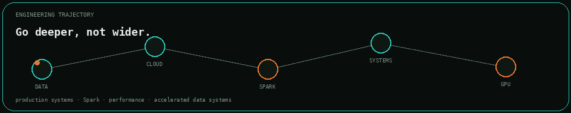

 

  
  &nbsp;
  
  &nbsp;
  

---

## Who Am I

> ### *"I build reliable data platforms — from raw inputs to decisions teams can trust."*

---

## Live Performance & Telemetry Graphs

---

## Systems Topography & Execution Engine

---

## Upstream Open Source Contributions

| Engine / Framework | Pull Request | Scope | Status |
| :--- | :---: | :--- | :--- |
| **NVIDIA cuDF Spark** | [#16688](https://github.com/NVIDIA/cudf-spark/pull/16688) | Spark Catalyst multi-digit patch versioning across build tooling & CI | Blossom CI Passed (30+ checks), Greptile 5/5 |
| **NVIDIA cuDF Spark** | [#16715](https://github.com/NVIDIA/cudf-spark/pull/16715) | `GpuCreateDataSourceTableAsSelectCommand` table drop on overwrite (SPARK-60387) | Greptile 5/5, Signed-off, Upstream Synced |
| **Apache Iceberg** | [#4265](https://github.com/apache/iceberg-python/pull/4265) | Snapshot ID invariant validation during branch expiration (#4200) | 20/20 CI Checks Passed |
| **Ibis Project** | [#12211](https://github.com/ibis-project/ibis/pull/12211) | Decimal mean type promotion (`float64`) & precision/scale (#12209) | Semantic Release Passed, DCO Signed |
| **Databricks dbt** | [#1758](https://github.com/databricks/dbt-databricks/pull/1758) | Relation string literal escaping for Unity Catalog queries (#1747) | 100% Test Coverage, 8/8 CI Passed |

---

## Flagship Blueprints: Sentinel Lakehouse & GenAI

<table>
  <tr>
    <td width="33%" valign="top">
      <h3><a href="https://github.com/MsMansiDhruv/sentinel-lakehouse">Sentinel Lakehouse</a></h3>
      
Medallion Lakehouse on Databricks with Auto Loader, Delta CDF, SCD1/2, Great Expectations gates, Genie AST Eval (~85ms), and AutoHeal-DE.

      
<code>Databricks</code> · <code>Delta Lake</code> · <code>sqlglot</code>

    </td>
    <td width="33%" valign="top">
      <h3><a href="https://github.com/MsMansiDhruv/gquery-engine-clone">GQuery Engine</a></h3>
      
In-memory vectorized columnar query execution engine (<code>RecordBatch</code>, bitmask filters, predicate pushdown).

      
<code>Columnar</code> · <code>Vectorized</code> · <code>Optimizer</code>

    </td>
    <td width="33%" valign="top">
      <h3><a href="https://github.com/MsMansiDhruv/dlt-doctor">dlt-doctor</a></h3>
      

        
      

      
Static AST optimizer &amp; diagnostic engine for Databricks Delta Live Tables &amp; PySpark Catalyst plans.

      
<code>pip install dlt-doctor</code>

    </td>
  </tr>
</table>

---

## LinkedIn Certifications, Badges & Honors

### 🎓 Verified Certifications

  
  
  
  
  
  
  
  
  
  
  
  

### 🏆 Honors & Awards

  
  
  
  
  

---

## Systems Stack

  
  &nbsp;&nbsp;&nbsp;
  
  &nbsp;&nbsp;&nbsp;
  
  &nbsp;&nbsp;&nbsp;
  
  &nbsp;&nbsp;&nbsp;
  
  &nbsp;&nbsp;&nbsp;
  
  &nbsp;&nbsp;&nbsp;
  
  &nbsp;&nbsp;&nbsp;
  
  &nbsp;&nbsp;&nbsp;
  
  &nbsp;&nbsp;&nbsp;
  
  &nbsp;&nbsp;&nbsp;
  

---

  Complexity → operability &nbsp;·&nbsp; <a href="https://portfolio-mansi-eight.vercel.app/">portfolio-mansi-eight.vercel.app</a> &nbsp;·&nbsp; Mansi Dhruv

