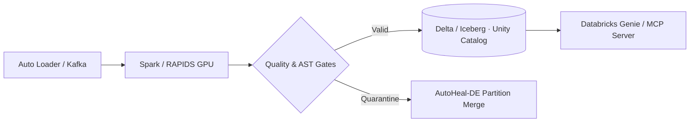

 

  
  &nbsp;
  
  &nbsp;
  
  &nbsp;
  

---

### Upstream Open Source & Engine Internals

<!-- OSS_PRS:START -->
| Engine / Repository | Pull Request | Technical Scope | Status |
| :--- | :---: | :--- | :--- |
| **databricks/dbt-databricks** | [#1787](https://github.com/databricks/dbt-databricks/pull/1787) | feat: support databricks_tags and liquid clustering for seeds (#1783) | Open (In Review) · 2026-11-21 |
| **databricks/dbt-databricks** | [#1786](https://github.com/databricks/dbt-databricks/pull/1786) | fix: preserve unconfigured row filters during table creation (#1782) | Closed · 2026-11-21 |
| **NVIDIA/cudf-spark** | [#16881](https://github.com/NVIDIA/cudf-spark/pull/16881) | Fix multithreaded read when maxNumFilesParallel is below task file count [r... | Open (In Review) · 2026-11-21 |
| **apache/iceberg-python** | [#4265](https://github.com/apache/iceberg-python/pull/4265) | Fix: assert ref snapshot id requirements during snapshot expiration (#4200) | Open (In Review) · 2026-11-21 |
| **NVIDIA/cudf-spark** | [#16938](https://github.com/NVIDIA/cudf-spark/pull/16938) | Implement TaskContext.addTaskPreCompletionListener in MockTaskContext [redu... | Open (In Review) · 2026-11-20 |
| **ibis-project/ibis** | [#12214](https://github.com/ibis-project/ibis/pull/12214) | fix(postgres): read query schema without temporary view DDL for read-only s... | Open (In Review) · 2026-11-16 |
| **delta-io/delta-rs** | [#5028](https://github.com/delta-io/delta-rs/pull/5028) | feat(python): support tuple filters in write, update, and delete predicates... | Open (In Review) · 2026-11-08 |
| **ibis-project/ibis** | [#12211](https://github.com/ibis-project/ibis/pull/12211) | fix(expr): type decimal mean as float64 and decimal product with combined s... | Open (In Review) · 2026-11-03 |
<!-- OSS_PRS:END -->

---

### Flagship Systems

<table>
  <tr>
    <td width="33%" valign="top">
      <h4><a href="https://github.com/MsMansiDhruv/sentinel-lakehouse">Sentinel Lakehouse</a></h4>
      
Medallion Lakehouse on Databricks featuring Auto Loader, Delta CDF, SCD1/SCD2, Great Expectations quarantine gates, offline SQLGlot AST eval (~85ms), and AutoHeal-DE partition recovery.

      
<code>Databricks</code> · <code>Delta Lake</code> · <code>sqlglot</code>

    </td>
    <td width="33%" valign="top">
      <h4><a href="https://github.com/MsMansiDhruv/gquery-engine-clone">GQuery Relational Engine</a></h4>
      
In-memory vectorized columnar query execution engine exploring contiguous <code>ColumnVector</code> chunks, <code>RecordBatch</code> iteration, bitmask filters, and rule-based pushdown.

      
<code>Columnar</code> · <code>Vectorized</code> · <code>Optimizer</code>

    </td>
    <td width="33%" valign="top">
      <h4><a href="https://github.com/MsMansiDhruv/dlt-doctor">dlt-doctor</a></h4>
      

        
        
      

      
Open-source static AST optimizer, diagnostic engine, and built-in <strong>MCP server</strong> (<code>dlt-doctor mcp</code>) for Databricks DLT and PySpark Catalyst plans.

      
<code>pip install dlt-doctor</code> · <code>MCP</code>

    </td>
  </tr>
</table>

---

### Reference Lakehouse & AI Architecture

---

### Recent Architecture Notes & Case Studies

<!-- ARCH_NOTES:START -->
- **[Legacy Data Modernization](https://portfolio-mansi-eight.vercel.app/projects/project-amc-datalake-solution)** (`2025-03`) — Cloud-native lake, Glue ETL, and Redshift analytics
- **[Productionizing an ML-Driven Allocation Engine](https://portfolio-mansi-eight.vercel.app/projects/brain-mvp)** (`2025-02`) — End-to-end ML allocation — eligibility, classification, and production serving on AWS
- **[Automated Web Intelligence Pipeline](https://portfolio-mansi-eight.vercel.app/projects/automated-intelligence-pipeline)** (`2025-01`) — Crawlers, extraction, deduplication, and DS model integration on AWS
- **[From OLAP to Workload-Specific Architecture](https://portfolio-mansi-eight.vercel.app/projects/olap-workload-architecture)** (`2024-12`) — Production migration — Redshift cost signal, engine benchmarks, workload separation
<!-- ARCH_NOTES:END -->

---

### Certifications, Credentials & Honors

  
  &nbsp;
  
  &nbsp;
  
  &nbsp;
  
  &nbsp;
  
  &nbsp;
  
  &nbsp;
  
  &nbsp;
  

  
  &nbsp;
  
  &nbsp;
  
  &nbsp;
  
  &nbsp;
  
  &nbsp;
  
  &nbsp;
  
  &nbsp;
  
  &nbsp;
  
  &nbsp;
  
  &nbsp;
  
  &nbsp;
  
  &nbsp;
  
  &nbsp;
  
  &nbsp;
  
  &nbsp;
  

---

  
  &nbsp;&nbsp;
  
  &nbsp;&nbsp;
  
  &nbsp;&nbsp;
  
  &nbsp;&nbsp;
  
  &nbsp;&nbsp;
  
  &nbsp;&nbsp;
  
  &nbsp;&nbsp;
  
  &nbsp;&nbsp;
  
  &nbsp;&nbsp;
  
  &nbsp;&nbsp;
  

  Complexity → operability &nbsp;·&nbsp; <a href="https://portfolio-mansi-eight.vercel.app/">portfolio-mansi-eight.vercel.app</a>

