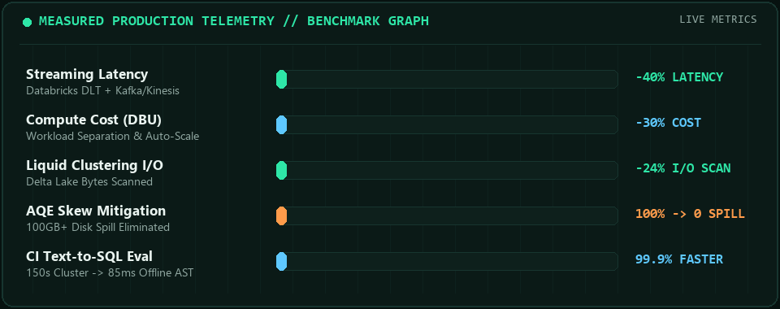
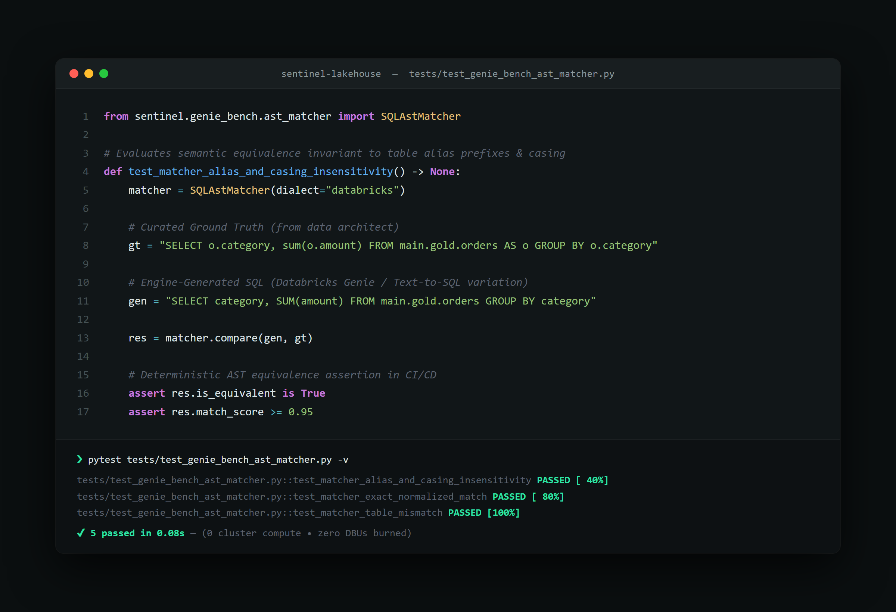

 

  
  &nbsp;
  
  &nbsp;
  
  &nbsp;
  

---

### Upstream Open Source & Engine Internals

| Engine / Framework | Pull Request | Technical Scope | CI / Review Status |
| :--- | :---: | :--- | :--- |
| **NVIDIA cuDF Spark** | [#16688](https://github.com/NVIDIA/cudf-spark/pull/16688) | Spark Catalyst multi-digit patch versioning across build tooling & CI | Blossom CI Passed (30+ checks) · Greptile 5/5 |
| **NVIDIA cuDF Spark** | [#16715](https://github.com/NVIDIA/cudf-spark/pull/16715) | `GpuCreateDataSourceTableAsSelectCommand` table drop on overwrite (`SPARK-60387`) | Greptile 5/5 · Signed-off · Upstream Synced |
| **Apache Iceberg** | [#4265](https://github.com/apache/iceberg-python/pull/4265) | Snapshot ID invariant validation during branch expiration (`#4200`) | 20/20 CI Checks Passed |
| **Ibis Project** | [#12211](https://github.com/ibis-project/ibis/pull/12211) | Decimal mean type promotion (`float64`) & precision/scale (`#12209`) | Semantic Release Passed · DCO Signed |
| **Databricks dbt** | [#1758](https://github.com/databricks/dbt-databricks/pull/1758) | Relation string literal escaping for Unity Catalog queries (`#1747`) | 100% Test Coverage · 8/8 CI Passed |

---

### Production Telemetry & Verifiable Engineering

<table>
  <tr>
    <td width="50%" valign="top">
      
    </td>
    <td width="50%" valign="top">
      
    </td>
  </tr>
</table>

---

### Flagship Systems

<table>
  <tr>
    <td width="33%" valign="top">
      <h4><a href="https://github.com/MsMansiDhruv/sentinel-lakehouse">Sentinel Lakehouse</a></h4>
      
Medallion Lakehouse on Databricks featuring Auto Loader, Delta CDF, SCD1/SCD2, Great Expectations quarantine gates, offline SQLGlot AST eval (~85ms), and AutoHeal-DE partition recovery.

      
<code>Databricks</code> · <code>Delta Lake</code> · <code>sqlglot</code>

    </td>
    <td width="33%" valign="top">
      <h4><a href="https://github.com/MsMansiDhruv/gquery-engine-clone">GQuery Relational Engine</a></h4>
      
In-memory vectorized columnar query execution engine exploring contiguous <code>ColumnVector</code> chunks, <code>RecordBatch</code> iteration, bitmask filters, and rule-based pushdown.

      
<code>Columnar</code> · <code>Vectorized</code> · <code>Optimizer</code>

    </td>
    <td width="33%" valign="top">
      <h4><a href="https://github.com/MsMansiDhruv/dlt-doctor">dlt-doctor</a></h4>
      

      
Open-source static AST optimizer &amp; diagnostic engine for Databricks Delta Live Tables and PySpark Catalyst plans.

      
<code>pip install dlt-doctor</code>

    </td>
  </tr>
</table>

---

### Verified Credentials & Leadership Recognition

  
  &nbsp;
  
  &nbsp;
  
  &nbsp;
  
  &nbsp;
  

View Specialized Data &amp; Cloud Coursework (LinkedIn Archive)

 

* **Big Data Analytics using Spark** — edX
* **Building Your First ETL Pipeline Using Azure Databricks** — Pluralsight
* **Set up PySpark for Data Analysis** — Pluralsight
* **SQL for Data Analysis and Data Science** — [Verified Certificate](https://www.udemy.com/certificate/UC-a6a6cbcf-d2b6-4b93-925e-0bcf1e777205/)
* **Docker Essentials** — [Verified Certificate](https://www.udemy.com/certificate/UC-XNDH2JI1/)
* **Machine Learning Using Python** — [Verified Certificate](https://www.udemy.com/certificate/UC-98742817-dfc1-415d-be88-c70c692ff871/)

---

  
  &nbsp;&nbsp;
  
  &nbsp;&nbsp;
  
  &nbsp;&nbsp;
  
  &nbsp;&nbsp;
  
  &nbsp;&nbsp;
  
  &nbsp;&nbsp;
  
  &nbsp;&nbsp;
  
  &nbsp;&nbsp;
  
  &nbsp;&nbsp;
  
  &nbsp;&nbsp;
  

  Complexity → operability &nbsp;·&nbsp; <a href="https://portfolio-mansi-eight.vercel.app/">portfolio-mansi-eight.vercel.app</a>

