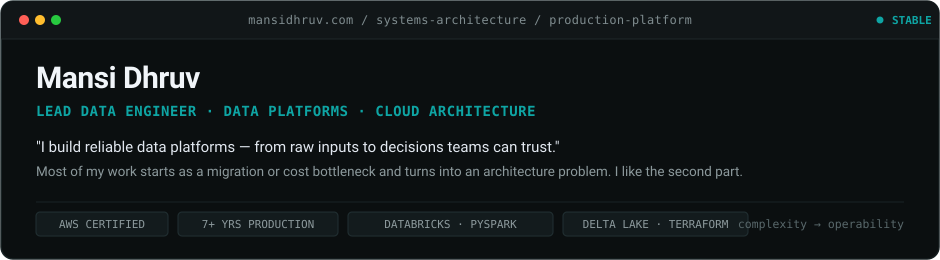

<div align="center">



<br/>

<p align="center">
  <a href="https://portfolio-mansi-eight.vercel.app/"><strong>Portfolio</strong></a> &nbsp;·&nbsp;
  <a href="https://portfolio-mansi-eight.vercel.app/projects"><strong>Architecture Case Studies</strong></a> &nbsp;·&nbsp;
  <a href="https://www.linkedin.com/in/mansidhruv/"><strong>LinkedIn</strong></a> &nbsp;·&nbsp;
  <a href="mailto:mansi.p.dhruv@gmail.com"><strong>Email</strong></a>
</p>

</div>

---

### 💭 How I Think

> *"I'd rather ship a boring reliable pipeline than a clever fragile one."*

* **Cost is an architecture concern, not an invoice surprise:** Every system decision has an operational cost—you choose where and when you pay it.
* **Observability isn't a dashboard:** It's knowing when to worry, bounding the blast radius, and automating recovery before downstream consumers are impacted.
* **Workload separation over single-store compromises:** When one database is struggling under simultaneous OLTP and OLAP demands, the flaw is usually the workload mix, not the engine.
* **Operability first:** Good systems should be explainable and maintainable by the person operating them, not just the architect who designed them.

---

### ⚡ Core Production Systems & Labs

<table>
  <tr>
    <td width="50%" valign="top">
      <h3><a href="https://github.com/MsMansiDhruv/sentinel-lakehouse">Sentinel Lakehouse &amp; Sentinel-GenAI</a></h3>
      <p><strong>Flagship Enterprise Architecture</strong></p>
      <p>Production Medallion Lakehouse on Databricks featuring Auto Loader incremental streaming, Delta Change Data Feed (CDF), SCD Type 1 &amp; Type 2 dimensional models, and Great Expectations quarantine gates.</p>
      <ul>
        <li><strong>Genie-Bench:</strong> Offline SQLGlot AST equivalence engine evaluating generated SQL in ~85ms without burning DBU compute.</li>
        <li><strong>AutoHeal-DE:</strong> Zero-scan Delta commit log monitor detecting late-arriving partitions and executing surgical partition-pruned Delta MERGE restatements.</li>
      </ul>
      <p><code>Databricks</code> · <code>Delta Lake</code> · <code>PySpark</code> · <code>Unity Catalog</code> · <code>sqlglot</code> · <code>CI/CD</code></p>
    </td>
    <td width="50%" valign="top">
      <h3><a href="https://github.com/MsMansiDhruv/gquery-engine-clone">GQuery Relational Engine</a></h3>
      <p><strong>Vectorized Columnar Execution Laboratory</strong></p>
      <p>In-memory relational query execution engine built from first principles to explore database internals beyond traditional row-at-a-time (Volcano iterator) models.</p>
      <ul>
        <li><strong>Columnar Vectors:</strong> Contiguous typed buffers (<code>ColumnVector</code>) passed as vectorized batches (<code>RecordBatch</code>) to minimize CPU instruction cache misses.</li>
        <li><strong>Rule-Based Optimizer:</strong> Predicate pushdown and column projection pruning prior to physical execution.</li>
        <li><strong>Bitmask Filtering:</strong> Boolean selection vectors to eliminate per-row heap allocations.</li>
      </ul>
      <p><code>Execution Engine</code> · <code>Columnar Layout</code> · <code>SIMD Vectorization</code> · <code>Memory Planning</code></p>
    </td>
  </tr>
  <tr>
    <td width="50%" valign="top">
      <h3><a href="https://github.com/MsMansiDhruv/dlt-doctor">dlt-doctor</a></h3>
      <p>
        <a href="https://pypi.org/project/dlt-doctor/"></a>
        <a href="https://github.com/MsMansiDhruv/dlt-doctor/releases/tag/v0.4.2"></a>
        <a href="https://github.com/marketplace/actions/dlt-doctor"></a>
      </p>
      <p><strong>Databricks DLT &amp; PySpark Static AST Optimizer</strong></p>
      <p>Open-source static analysis engine for Databricks Delta Live Tables. Audits Catalyst plan bloat, enforces zero-loss quarantine pipelines, advises on Liquid Clustering, and forecasts DBU workload costs before deployment.</p>
      <p><code>pip install dlt-doctor</code> · <code>PySpark Catalyst</code> · <code>Delta Live Tables</code> · <code>GitHub Action</code></p>
    </td>
    <td width="50%" valign="top">
      <h3><a href="https://github.com/MsMansiDhruv/sentinel-lakehouse/blob/main/notebooks/14_sentinel_genai_hybrid_rag.ipynb">Sentinel-GenAI Studio</a></h3>
      <p><strong>Databricks AI/BI &amp; Hybrid RAG Engine</strong></p>
      <p>Compound data intelligence architecture fusing structured Databricks SQL aggregations with unstructured Mosaic AI Vector Search chunks via Reciprocal Rank Fusion (RRF k=60).</p>
      <ul>
        <li>Enforces schema constraints and numerical guardrails on LLM outputs.</li>
        <li>Eliminates hallucinated entity references against Unity Catalog metadata.</li>
      </ul>
      <p><code>Mosaic AI</code> · <code>Databricks Genie</code> · <code>Vector Search</code> · <code>Reciprocal Rank Fusion</code></p>
    </td>
  </tr>
</table>

---

### 🌐 Upstream Open Source Contributions

Contributions to core data systems, query engines, and table formats:

| Repository | Focus & Scope | Pull Request | Impact / Status |
| :--- | :--- | :---: | :--- |
| **`NVIDIA/cudf-spark`** | Spark Catalyst multi-digit patch versioning across build tooling and CI | [#16688](https://github.com/NVIDIA/cudf-spark/pull/16688) | Blossom CI Passed (30+ checks green), Greptile 5/5 |
| **`NVIDIA/cudf-spark`** | `GpuCreateDataSourceTableAsSelectCommand` table drop on `saveAsTable` overwrite (SPARK-60387) | [#16715](https://github.com/NVIDIA/cudf-spark/pull/16715) | Greptile 5/5, Signed-off, Upstream Synced |
| **`apache/iceberg-python`** | Invariant validation on reference snapshot IDs during branch snapshot expiration | [#4265](https://github.com/apache/iceberg-python/pull/4265) | 20/20 CI Passed, In maintainer review queue |
| **`ibis-project/ibis`** | Decimal mean type promotion (`float64`) and product precision/scale calculation | [#12211](https://github.com/ibis-project/ibis/pull/12211) | Semantic Release passed, DCO signed |
| **`databricks/dbt-databricks`** | Relation string literal escaping for metadata queries against catalogs and schemas | [#1758](https://github.com/databricks/dbt-databricks/pull/1758) | 100% PR Test Coverage, 8/8 CI checks passed |

---

### 🏗️ Enterprise Architecture Case Studies

*Documented client platforms and cloud migrations from [portfolio-mansi-eight.vercel.app](https://portfolio-mansi-eight.vercel.app/projects):*

* **Legacy Data Modernization (Asset Management)**: Designed and executed the cloud-native lakehouse migration on AWS (S3, Glue, Redshift, DMS, Power BI). Modernized 10+ TB of financial records, establishing automated schema validation and delivering 40% automation efficiency.
* **Streaming Lakehouse & Real-Time Scoring (Fintech / Acorns)**: Architected end-to-end streaming scoring pipelines using Databricks, PySpark, Delta Live Tables, and Kafka/Kinesis. Cut end-to-end latency by 40% while reducing cluster compute costs by 30%.
* **Workload-Specific Architecture**: De-coupled a monolithic warehouse handling simultaneous OLTP transactions and heavy analytics. Migrated transaction logging to DynamoDB/Aurora while directing analytical aggregation to Redshift and S3 Tables.

---

### 📊 Measured Production Benchmarks

| Objective | Baseline | Measured Outcome | Systems Mechanism |
| :--- | :--- | :--- | :--- |
| **I/O &amp; File Pruning** | Full table partition scans | **24% bytes scanned reduction** | Delta Lake Liquid Clustering tuned against query predicate cardinality |
| **Memory &amp; Spill Mitigation** | 100GB+ disk spills on skew | **Zero disk spill** | AQE dynamic skew split and adaptive broadcast join thresholds |
| **Pipeline Latency** | Multi-hour batch windows | **40% latency acceleration** | Micro-batch streaming with Delta Change Data Feed (CDF) |
| **Compute Cost** | Over-provisioned static clusters | **30% DBU savings** | Workload separation, auto-scaling pools, and spot instance integration |
| **CI/CD Text-to-SQL Eval** | 2-3 min live cluster runs | **~85ms in-memory eval** | Offline SQLGlot AST equivalence verification with CTE scope isolation |

---

### 📜 Verified Credentials & Leadership

* **AWS Certified Cloud Practitioner** — Amazon Web Services (2023)
* **GEM Award (2023)** — SG Analytics: *Awarded for delivering exceptional business value and architecture leadership on enterprise client data platforms.*
* **Value-able Award (2024)** — SG Analytics: *Recognized for establishing critical client architectural foundations.*
* **Master in Computer Applications (MCA)** — AESICS: *Full Year Merit-Based Scholarship recipient.*

---

### 🛠️ Production Toolchain

```text
Cloud & Platforms  : AWS (S3, Glue, Redshift, Lambda, DMS), Databricks, Unity Catalog
Engines & Formats  : Apache Spark, PySpark, Delta Lake, Apache Iceberg, DuckDB
Languages & Logic  : Python, SQL, C++, Bash
Orchestration & CI : Apache Airflow, Delta Live Tables, Terraform, Docker, GitHub Actions
Testing & Quality  : pytest, Great Expectations, sqlglot, dlt-doctor
```

---

<div align="center">
  <sub>Built for operability · <a href="https://portfolio-mansi-eight.vercel.app/">portfolio-mansi-eight.vercel.app</a> · Mansi Dhruv</sub>
</div>
