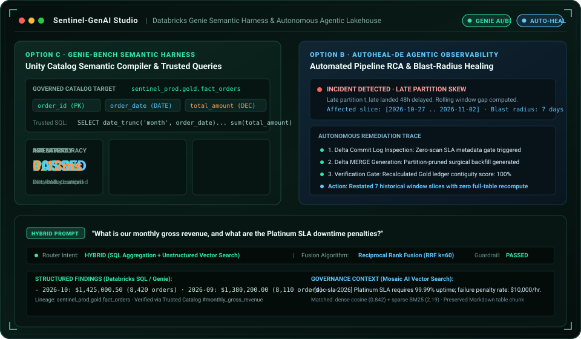

  <em><strong>"Less hype. More engineering."</strong></em>

  
  &nbsp;
  
  &nbsp;
  
  &nbsp;
  
  &nbsp;
  
  &nbsp;
  
  &nbsp;
  

---

### About Me

I build and tune production data platforms across **Databricks, Apache Spark, Delta Lake, and AWS**.

Most data problems aren't solved by adding more tools—they're solved by understanding what the query engine is doing underneath the hood. Over 7+ years, my work has centered on the mechanics of scale: eliminating 100GB+ disk spills in Spark, catching silent data drops before they corrupt financial ledgers, pruning millions of unnecessary file scans with Liquid clustering, and cutting cloud compute waste.

When standard JVM runtimes hit their limits, I look at the execution primitives: vectorized execution, off-heap memory, and GPU kernel offload with **NVIDIA RAPIDS (cuDF)**. For the modern agentic tier, I build native **Model Context Protocol (MCP)** tools and semantic layers that give AI reasoning engines structured, reliable access to enterprise lakehouses without hallucinations.

---

### What I Focus On

| Experience | Migration Scale | Open Source PRs | Ecosystem Rating |
| :---: | :---: | :---: | :---: |
| **7+ Years** Enterprise Platforms | **10+ TB** Financial Lakehouse | **7** Upstream Engine PRs | **Grade A (100%)** on Glama |

 

| Engineering Focus | What I Solve in Production | Measured Result |
| :--- | :--- | :--- |
| **Spark & Memory Tuning** | Skew join resolution via AQE adaptive splitting, broadcast threshold tuning, off-heap allocation | Eliminated **100GB+ disk spills** and zero JVM GC pauses |
| **Lakehouse Architecture & I/O** | Medallion design (Bronze → Silver → Gold), Delta Lake Liquid clustering, Change Data Feed (CDF) | **24% I/O scan reduction** across high-cardinality analytical predicates |
| **Cloud Migrations & Streaming** | Automated metadata-driven AWS Glue & DMS pipelines from legacy SQL Server to Redshift, Terraform IaC | **10+ TB financial data** migrated with **40% lower OPEX** and zero loss |
| **Hardware Acceleration** | Columnar vectorized query execution, memory-mapped buffers, SIMD GPU offload with NVIDIA RAPIDS (cuDF) | Replaced heavy JVM iteration loops with parallel GPU kernel execution |
| **Agentic AI & Lakehouse MCP** | Offline AST static code analysis (`dlt-doctor`), Unity Catalog semantic harnesses, Model Context Protocol | Production AI agents querying lakehouse tables with zero hallucinations |

---

### Production Benchmarks

- **I/O & Predictive File Pruning**: Liquid clustering reduced bytes scanned by **24%** across analytical predicates, measured against serverless cluster startup overheads.
- **Memory & Shuffle Optimization**: Mitigated high-cardinality skew via AQE dynamic partition splitting and adaptive broadcast switching, eliminating **100GB+ disk spills**.
- **Real-Time Stream Processing**: Engineered end-to-end streaming scoring with **40% latency acceleration** and **30% compute cost reduction** on Databricks Delta Live Tables.
- **Metadata-Driven Cloud Migration**: Automated migration of **10+ TB** financial data to AWS Redshift/Lakehouse with reproducible Terraform IaC and zero-loss observability.

---

### Under the Hood: Spark Internals & GPU Acceleration

---

### Featured Projects

<table>
  <tr>
    <td width="33%" valign="top">
      <h4><a href="https://github.com/MsMansiDhruv/dlt-doctor">dlt-doctor</a></h4>
      

        
        
      

      
Offline static AST analysis engine, optimizer, and native <strong>Model Context Protocol (MCP)</strong> server for Databricks Delta Live Tables, Lakeflow, and PySpark Catalyst plans.

      
<code>uvx dlt-doctor analyze .</code> · <code>MCP</code>

    </td>
    <td width="33%" valign="top">
      <h4><a href="https://github.com/MsMansiDhruv/sentinel-lakehouse">Sentinel Lakehouse</a></h4>
      

        
        
      

      
Production lakehouse featuring Auto Loader, Delta CDF, SCD1/SCD2, Great Expectations quarantine gates, offline SQLGlot AST eval, and <strong>AutoHeal-DE</strong> partition recovery.

      
<code>Databricks</code> · <code>Delta Lake</code> · <code>sqlglot</code>

    </td>
    <td width="33%" valign="top">
      <h4><a href="https://github.com/MsMansiDhruv/gquery-engine-clone">GQuery Relational Engine</a></h4>
      

        
        
      

      
In-memory vectorized columnar query engine exploring contiguous <code>ColumnVector</code> chunks, <code>RecordBatch</code> iteration, bitmask filters, and pushdown optimizations.

      
<code>Columnar</code> · <code>Vectorized</code> · <code>C++ / Python</code>

    </td>
  </tr>
</table>

---

### Lakehouse AI & Agentic Systems

**Databricks Genie AI/BI · Mosaic AI Vector Search · Autonomous Observability · Compound Query Routing**

- **Genie-Bench (Semantic Harness)**: Generates Unity Catalog annotations, join graphs, and a validated **Trusted SQL Catalog** to prevent metric hallucinations when business users query lakehouses.
- **AutoHeal-DE (Automated Observability & RCA)**: Scans live Delta transaction logs to detect late-arriving partitions, isolates affected date ranges, and writes surgical partition-pruned Delta `MERGE` statements without expensive full-table recomputations.
- **Hybrid Compound Router**: Blends structured Databricks SQL queries with unstructured Mosaic AI Vector Search using Reciprocal Rank Fusion (RRF k=60), backed by strict numerical consistency checks.

---

### Upstream Open Source PRs

<!-- OSS_PRS:START -->
| Engine / Repository | Pull Request | Technical Scope | Status |
| :--- | :---: | :--- | :--- |
| **punkpeye/awesome-mcp-servers** | [#20359](https://github.com/punkpeye/awesome-mcp-servers/pull/20359) | Add MsMansiDhruv/dlt-doctor to Data Platforms 🤖🤖🤖 | Open (In Review) · 2026-11-27 |
| **NVIDIA/cudf-spark** | [#16881](https://github.com/NVIDIA/cudf-spark/pull/16881) | Fix multithreaded read when maxNumFilesParallel is below task file count [r... | Open (In Review) · 2026-11-27 |
| **delta-io/delta-rs** | [#5126](https://github.com/delta-io/delta-rs/pull/5126) | feat(merge): use exact source keys to prune streamed MERGE scans (#5120) | Open (In Review) · 2026-11-27 |
| **NVIDIA/cudf-spark** | [#16939](https://github.com/NVIDIA/cudf-spark/pull/16939) | Support aggregate formatting in driverless broadcast metric assertion [redu... | Open (In Review) · 2026-11-26 |
| **databricks/dbt-databricks** | [#1758](https://github.com/databricks/dbt-databricks/pull/1758) | fix: escape relation string literals in metadata queries (#1747) | Open (In Review) · 2026-11-22 |
| **databricks/dbt-databricks** | [#1787](https://github.com/databricks/dbt-databricks/pull/1787) | feat: support databricks_tags and liquid clustering for seeds (#1783) | Open (In Review) · 2026-11-22 |
| **apache/iceberg-python** | [#4265](https://github.com/apache/iceberg-python/pull/4265) | Fix: assert ref snapshot id requirements during snapshot expiration (#4200) | Open (In Review) · 2026-11-21 |
| **ibis-project/ibis** | [#12214](https://github.com/ibis-project/ibis/pull/12214) | fix(postgres): read query schema without temporary view DDL for read-only s... | Open (In Review) · 2026-11-16 |
<!-- OSS_PRS:END -->

---

### Case Studies & Architecture Notes

<!-- ARCH_NOTES:START -->
- **[Legacy Data Modernization](https://portfolio-mansi-eight.vercel.app/projects/project-amc-datalake-solution)** (`2025-03`) — Cloud-native lake, Glue ETL, and Redshift analytics
- **[Productionizing an ML-Driven Allocation Engine](https://portfolio-mansi-eight.vercel.app/projects/brain-mvp)** (`2025-02`) — End-to-end ML allocation — eligibility, classification, and production serving on AWS
- **[Automated Web Intelligence Pipeline](https://portfolio-mansi-eight.vercel.app/projects/automated-intelligence-pipeline)** (`2025-01`) — Crawlers, extraction, deduplication, and DS model integration on AWS
- **[From OLAP to Workload-Specific Architecture](https://portfolio-mansi-eight.vercel.app/projects/olap-workload-architecture)** (`2024-12`) — Production migration — Redshift cost signal, engine benchmarks, workload separation
<!-- ARCH_NOTES:END -->

---

### Certifications & Awards

  
  &nbsp;
  
  &nbsp;
  
  &nbsp;
  
  &nbsp;
  
  &nbsp;
  
  &nbsp;
  
  &nbsp;
  

  
  &nbsp;
  
  &nbsp;
  
  &nbsp;
  
  &nbsp;
  
  &nbsp;
  
  &nbsp;
  
  &nbsp;
  
  &nbsp;
  
  &nbsp;
  
  &nbsp;
  
  &nbsp;
  
  &nbsp;
  
  &nbsp;
  
  &nbsp;
  
  &nbsp;
  
  &nbsp;
  

---

### Tech Stack

  
  &nbsp;&nbsp;&nbsp;
  
  &nbsp;&nbsp;&nbsp;
  
  &nbsp;&nbsp;&nbsp;
  
  &nbsp;&nbsp;&nbsp;
  
  &nbsp;&nbsp;&nbsp;
  
  &nbsp;&nbsp;&nbsp;
  
  &nbsp;&nbsp;&nbsp;
  
  &nbsp;&nbsp;&nbsp;
  
  &nbsp;&nbsp;&nbsp;
  
  &nbsp;&nbsp;&nbsp;
  
  &nbsp;&nbsp;&nbsp;
  

  Data Platforms · Distributed Query Engines · Performance Architecture &nbsp;·&nbsp; <a href="https://portfolio-mansi-eight.vercel.app/">portfolio-mansi-eight.vercel.app</a>

